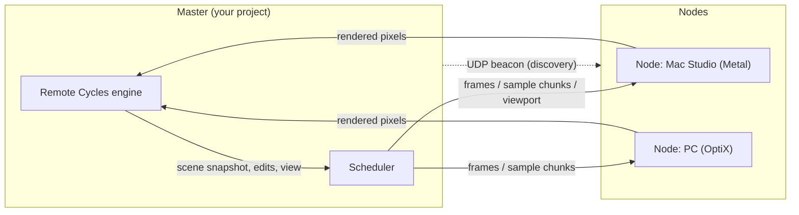

# Remote Cycles

**A render cluster for Blender on your local network.** Work on a machine with no usable
GPU and let the GPUs of your other computers render: the viewport, single images and
animations, all through Blender's normal buttons.

- The **rendered viewport** streams from another machine's GPU while you model.
- **F12** splits one image across every GPU in the cluster and merges the result,
  identical to rendering it on one machine.
- **Ctrl+F12** hands animation frames to whichever GPU is free, fastest first.
- Machines **find each other automatically**. No IP addresses, no servers to start.
- Every machine runs the same add-on; nodes rank themselves with a built-in benchmark.

> Tested with Blender 5.2 on Linux. Nodes can be any OS Cycles supports (Metal, OptiX,
> CUDA, HIP, oneAPI, or CPU).

## Contents

- [Installation](#installation)
- [Quick start](#quick-start)
- [Using it](#using-it)
- [How it works](#how-it-works)
- [Network and firewalls](#network-and-firewalls)
- [Troubleshooting](#troubleshooting)
- [Limitations](#limitations)
- [Development](#development)

## Installation

Do this on **every** machine, all with the same Blender version (e.g. all 5.2.x):

1. Download `remote_cycles-<version>.zip` from the
   [Releases](https://github.com/maksym-chubatyuk/blender_remote_cycles/releases) page
   (or [build it yourself](#building-the-zip)).
2. In Blender: **Edit → Preferences → Get Extensions**, open the **⌄** menu in the top
   right corner, choose **Install from Disk…** and select the zip. (Dragging the zip onto
   the Blender window works too.)

The add-on is enabled right away. To update, install the newer zip the same way.

## Quick start

Two roles, decided simply by what you click:

- **Master**: the Blender with your project open and **Remote Cycles** as its render
  engine. Only then does it announce itself to the other machines.
- **Node**: a Blender on another machine that **joins** the master and renders for it.

The master renders with its own devices too (see
[Choosing machines and devices](#choosing-machines-and-devices)).

1. **On the machine with your project** (the master): open your `.blend` file and set
   **Render Properties → Render Engine** to **Remote Cycles**.
2. **On each GPU machine** (a node): open Blender, press **N** in the 3D viewport to show
   the sidebar, open the **Cluster** tab and click **Join** next to the master's name.

   The node benchmarks its GPU once (a few seconds), loads your scene and is ready. Its
   window shows *Rendering for <master>*.
3. Back on the master, **Render Properties → Render Cluster** (below the Cycles panels)
   lists every machine and its devices. Render as you normally would.

> **Joining replaces the node's open file.** While joined, a node is dedicated to the
> master; it asks before discarding unsaved changes. **Leave** reloads its start-up file.

With **Auto-Join** on (the default), a machine that has joined a master once rejoins it on
its own whenever that master shows up, so afterwards you only need to open Blender there.

## Using it

### Viewport

Switch the 3D viewport to **Rendered** shading. The image streams in from the node that
can deliver frames fastest, counting both its GPU speed and its network speed, and gets
cleaner over time up to the *Viewport* sample count in **Render Properties → Sampling**.
Overlays, gizmos and color management work as usual because they are drawn locally.

Edits show up immediately: moving objects, hiding them, changing frames and navigating
are sent as tiny updates; other edits (modeling, materials, lights, settings) send a
fresh copy of the scene a moment after you stop changing things. If something ever looks
out of date, **Render Properties → Render Cluster → Resync Scene** sends a full copy.

The viewport text overlay shows which node is rendering and the current sample count.

### Rendering an image (F12)

- **Two or more nodes:** the image's samples are split between them. Faster nodes get
  bigger chunks, and chunks get smaller as the work runs out so no GPU sits waiting for
  another. The pieces are merged on the master and then denoised once.
- **One node:** the whole image renders there, with adaptive sampling and denoising.

Blender's usual render window opens; the progress bar and status text show the samples
finished and which machines are working, and the image appears when the pieces are merged.
Compositing and saving happen on the master, exactly as with a normal render.

### Rendering an animation (Ctrl+F12)

Every node takes the next unrendered frame as soon as it is free, fastest node first.
Toward the end, an idle fast node re-renders a frame still running on a slow node if it
would finish it sooner, so the last frames do not wait on the slowest machine. Frames are
saved to your output path in order, as usual. Existing frames are skipped when
**Overwrite** is off.

You get **one window per machine**: each shows the last frame that machine finished, and
its title says which frame that was and what it is rendering now, e.g.
`mac-studio: frame 12 done, rendering 15`. Blender's own render window becomes the first
machine's window, so two machines means two windows. Close any you don't need; they stay
closed for the rest of that animation.

### Choosing machines and devices

**Render Properties → Render Cluster** lists every machine with its benchmark score
(millions of samples per second), network speed and current status, and under each one
the devices Cycles can use there: its GPUs and its CPU.

- Tick or untick a **machine** to include or leave it out entirely.
- Tick or untick **devices** to choose what that machine renders with, e.g. GPU only,
  or GPU + CPU. The machine re-benchmarks itself with the new selection.
- **Render on This Machine** includes the master's own devices; it appears as
  "<name> (this machine)". It runs as a background Blender process on the master,
  started and stopped automatically, because rendering inside the master's own window
  would freeze it. That holds the scene in memory twice on the master; untick it if
  memory is tight or if the master has no useful GPU.

All choices are remembered per machine name.

### Leaving

On a node, click **Leave Cluster** in the sidebar's **Cluster** tab. If the master quits,
its nodes leave on their own.

### Nodes without a window

A node can also run headless, e.g. on a machine you only reach over SSH:

```sh
blender -b --factory-startup --python run_node.py -- [--master HOST[:PORT]] [--join MASTER_NAME] [--cpu]
```

Without `--master` it waits for a master on the network; it rejoins after the master
restarts unless `--once` is given. `run_node.py` ships inside the add-on folder
(Blender's extensions directory, e.g.
`~/Library/Application Support/Blender/5.2/extensions/user_default/remote_cycles/` on macOS).

### Preferences

**Edit → Preferences → Add-ons → Remote Cycles**:

| Setting | Meaning |
| --- | --- |
| Machine Name | How this machine appears to others (defaults to the host name). Applies immediately. |
| Port | TCP port this Blender listens on for nodes (default 9876). Applies immediately. |
| Render on This Machine | As the master, also render with this machine's own devices. |
| Auto-Join | After joining a master once, rejoin it whenever it appears (not while this Blender is a master itself). |
| Compress Viewport Frames | Smaller viewport frames at some CPU cost; helps on Wi-Fi. |

Which devices each machine renders with is chosen on the master, in the Render Cluster
panel.

## How it works



- **Discovery:** the master broadcasts a small beacon every second; nodes list the masters
  they hear. Nodes then open a TCP connection to the master.
- **Scene transfer:** the master writes a snapshot `.blend` of the scene (plus any external
  image textures) and uploads it once; nodes cache uploads by content, so unchanged
  scenes and textures are never sent twice.
- **Ranking:** each node renders a small built-in scene on first join and reports
  samples per second (cached per GPU and Blender version). During animations, measured
  frame times refine the estimates.
- **Split stills:** Cycles' *sample subset* feature lets each node render a disjoint
  range of the same sample sequence. Weighted averaging of the ranges gives exactly the
  full render, which the master denoises with Cycles' own denoiser.
- **Viewport:** the node renders progressively larger sample chunks with different seeds
  and averages them, sending only the newest image as half floats. The master draws it
  with Blender's own color management.

## Network and firewalls

| Port | Protocol | Who listens |
| --- | --- | --- |
| 9876 (configurable) | TCP | the master |
| 9875 | UDP broadcast | everyone, for discovery |

- **macOS** asks once whether Blender may accept incoming network connections. Allow it,
  or the node cannot hear the master's announcements.
- Some routers, mesh Wi-Fi systems and guest networks block broadcasts. Discovery then
  shows nothing; type the master's address into the **Cluster** tab and click
  **Join Address** instead.
- All results flow into the master, so **its connection is the bottleneck**. Wired
  Ethernet on the master makes a large difference, especially for split stills, which
  send each node's full-precision render passes back once per image.
- There is no authentication beyond a node choosing to join. Use it on networks you trust.

## Troubleshooting

| Problem | What to check |
| --- | --- |
| The master does not appear on the node | Is its render engine set to **Remote Cycles**? Same network/subnet? macOS network permission allowed? Try **Join Address** with the master's IP. |
| "Blender version mismatch" | All machines need the same major.minor Blender version. |
| "Cannot host on port 9876" | Another Blender on the master already hosts. Close it or change the port in preferences. |
| Viewport says "Waiting for a render node to join" | No machine has joined (or this machine's own render process is still starting), or all are unticked in Render Cluster. |
| Textures missing on nodes | Linked libraries, UDIM tiles, image sequences and caches are not uploaded; pack them (**File → External Data → Pack Resources**) or use identical paths. |
| Viewport feels slow | Prefer Ethernet; on Wi-Fi enable **Compress Viewport Frames**. A smaller 3D viewport area also renders faster. |

## Limitations

- Linked libraries are not uploaded; make them local or keep identical paths on all
  machines. UDIM tiles, image sequences, movies, caches and volume files are not
  uploaded either.
- Split stills render without adaptive sampling. A still that uses both denoising and
  motion blur renders whole on the fastest node, because denoising a merged image needs
  the vector pass, which motion blur rules out.
- Split-still denoising runs on the master's CPU.
- The viewport uses one node at a time and has no denoising yet.
- Cancelling stops waiting and drops queued work; frames already rendering on a node
  finish there first.
- Node upload caches (`$TMPDIR/remote_cycles_cache`) are never pruned.
- A GPU that Cycles does not support (e.g. AMD Polaris/Vega) cannot be used; such a
  machine offers only its CPU.

## Development

```
__init__.py      registration, main-thread timer (hosting, auto-join, redraws)
ui.py            preferences, operators, panels
engine.py        the Remote Cycles RenderEngine (viewport + final renders)
master.py        hosting, node connections, job scheduling, merging, viewport sessions
node.py          joining, scene loading, rendering frames / sample chunks / viewport, benchmark
sync.py          scene snapshots and change detection
link.py          framed TCP connection with sender/receiver threads
protocol.py      wire format, discovery beacons, pass serialization
discovery.py     UDP beacon sender and listener
benchmark.py     the built-in benchmark scene
exr.py           minimal OpenEXR reader/writer (uncompressed, numpy only)
run_node.py      headless node entry point
tests/           end-to-end tests (see below)
```

To work on the add-on, link the repository into Blender's extensions folder instead of
installing a zip (remove an installed copy first, both use the id `remote_cycles`):

```sh
ln -s "$PWD" ~/.config/blender/5.2/extensions/user_default/remote_cycles   # Linux
```

### Tests

All tests compare remote results against local Cycles renders on the CPU.

```sh
# Master plus two headless CPU nodes of different speed: discovery, ranking, split stills
# (with/without denoising), single-node stills, animations and their tail, viewport, dropouts.
blender -b --factory-startup --python tests/test_cluster.py -- /tmp/rc_cluster

# A windowed node joins through discovery (opens a window briefly).
blender -b --factory-startup --python tests/test_gui_node.py -- /tmp/rc_guinode

# A windowed master with a headless node: what each kind of viewport edit sends.
blender --factory-startup --python tests/test_gui.py -- /tmp/rc_gui
```

### Building the zip

```sh
blender --command extension build --output-dir dist
```

## License

GPL-3.0-or-later, like Blender itself. See [LICENSE](LICENSE).
